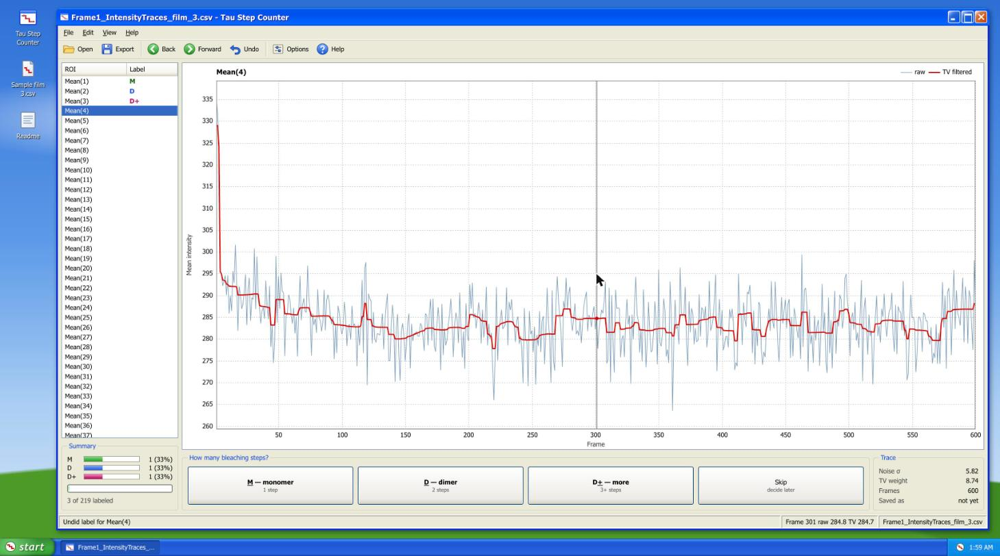

# Tau Step Counter

A small tool for counting **photobleaching steps** in single-molecule fluorescence traces. You open an intensity table exported from ImageJ / Fiji, look at each spot's trace next to a denoised version, and mark it as a monomer, a dimer or something bigger.

**Open it in the browser:** https://turb0eblan.github.io/tau-step-counter/

It runs entirely on your computer. Nothing is uploaded.



## Why

I built this together with my friend, biologist [Kudaybergen Bissenbayev](https://www.linkedin.com/in/kudaybergenbissenbayev/), for research on the protein **Tau**. Tau was tagged with sfGFP, imaged one molecule at a time at 100 pM (50 ms frames), and each bright spot was turned into an ROI in Fiji.

A GFP molecule doesn't fade gradually. It switches off in one sudden step. So if a spot's brightness drops in one step, the spot held one Tau molecule. Two steps means two molecules, a dimer, and more steps means a larger oligomer. Counting steps over a few hundred spots tells you how much Tau is clumping together.

Raw traces are noisy, so every trace is drawn together with a **total variation (TV) denoised** version, which flattens the noise but keeps the steps sharp.

## Using the web app

1. In Fiji: put ROIs on the spots, then *ROI Manager → More → Multi Measure* with *Mean gray value* on, and save the results as CSV. The columns should look like `Mean(1), Mean(2), ...`.
2. Open the CSV in the app (*File → Open*, or drag it onto the window). You can also try it on `examples/Frame1_IntensityTraces_film_3.csv`.
3. For each trace press **M** (1 step), **D** (2 steps) or **+** (3 or more). The app moves on to the next unlabeled trace by itself.
4. *File → Export labels* saves `roi_classification.csv`.

| Key | Action |
|---|---|
| `M` / `D` / `+` | label as monomer / dimer / more |
| `←` `→` | previous / next ROI |
| `N` | next unlabeled ROI |
| `Ctrl+Z` | undo |
| `R` | show / hide raw trace |
| drag on plot | zoom into frames, double-click to reset |

Your progress is kept in the browser, so you can close the tab and continue later. Exported files can be imported again with *File → Import labels*.

### Output

```
roi_column,label,tv_weight,noise_std,n_points
Mean(1),m,11.400721,7.600481,600
Mean(2),d,7.599956,5.066638,600
```

`label` is `m`, `d`, `d+`, or `too_short` for traces with fewer than 3 points.

## How the filter works

- **Noise level.** σ is estimated from successive differences of the trace with the median absolute deviation: `σ = MAD(diff(y)) / 0.6745 / √2`. Using the median means the few big jumps (the actual bleaching steps) don't inflate the estimate.
- **TV weight.** `weight = max(1.5 · σ, 1.0)`, so noisier traces get smoothed harder. Both numbers can be changed in *Options*.
- **Denoising.** Chambolle's projection algorithm (2004), up to 200 iterations. The JavaScript version in `js/signal.js` is a direct port of `skimage.restoration.denoise_tv_chambolle` and matches it to about 1e-12 on the example data.

## Python version

The original script is in `python/`. It does the same thing in a matplotlib window and writes the same CSV format, so you can switch between the two.

```bash
cd python
pip install -r requirements.txt
python parse_tau.py ../examples/Frame1_IntensityTraces_film_3.csv --out roi_classification.csv
```

Options: `--tv-multiplier`, `--min-weight`, `--max-iter`. If the output file already exists, the script skips ROIs that are already labeled.

## Running locally

It is a static page with no build step. Opening `index.html` directly works, except for the "Try the sample" button, which browsers block for `file://` pages. To get that button working too:

```bash
python3 -m http.server
# then open http://localhost:8000
```

## Authors

- **Artur Nam** ([@Turb0Eblan](https://github.com/Turb0Eblan)): code
- **Kudaybergen Bissenbayev** ([LinkedIn](https://www.linkedin.com/in/kudaybergenbissenbayev/)): biology, experiments and the example data

## License

MIT, see [LICENSE](LICENSE).
